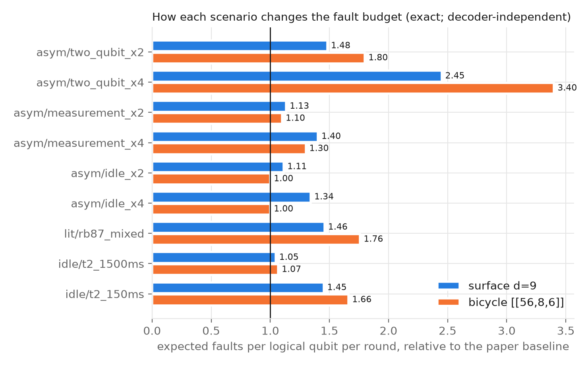
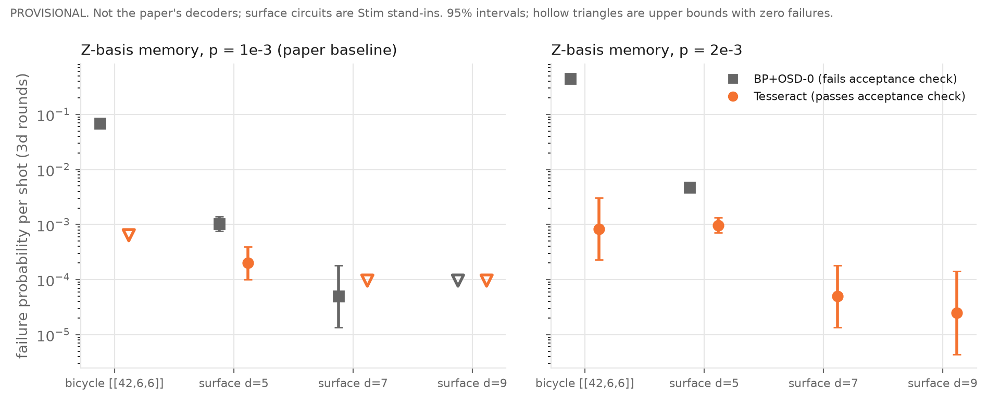

# Results

Two kinds of result are reported here and kept apart.

- **Part A, validated analytic results.** Exact counting and closed-form arithmetic. They do not
  depend on a decoder or on sampling, and the tests check them against hand calculations.
- **Part B, provisional sampled results.** They depend on a decoder that is not the paper's and, for
  the surface code, on a stand-in circuit. They are bounds and consistency checks. **They do not
  reproduce the paper's logical error rates.**

Part C is text for the group paper. Numbers behind figures 1-4 are in `figures/analytic.json`; raw
sampling records are in `results/udaya/`.

## Short answer to the research question

On memory alone, the bicycle chain's space advantage is large and robust to timing: at the paper's
code sizes it stores 64 logical qubits in 896 atoms against 10,304, and its syndrome cycle would have
to be 11.5 times slower than the surface code's, not 2 times, before the qubit-seconds were equal.
Realistic timing, in which readout takes a fixed time per round, moves the cycle ratio below 2 and
so helps the bicycle chain.

Non-uniform noise cuts the other way. The bicycle circuit's fault budget is 80% two-qubit gate error
against 48% for the surface circuit, so a hardware profile dominated by the CZ gate raises its fault
budget more (1.76 times against 1.46 times for a profile built from published Rb-87 fidelities).

Whether the advantage survives end to end, at matched logical error, is **not answered** by this
workstream. That needs a production decoder, the team's surface circuit and the algorithm volumes
(see HANDOFF.md).

## Part A. Validated analytic results

### A1. Memory footprint (figure 1)

| Logical qubits | Surface d = 9 | Bicycle [[56,8,6]] | Ratio | Unused bicycle capacity |
|---|---|---|---|---|
| 1 | 161 | 112 | 1.44 | 7 |
| 9 | 1,449 | 224 | 6.47 | 7 |
| 64 | 10,304 | 896 | 11.5 | 0 |
| 128 | 20,608 | 1,792 | 11.5 | 0 |

Data qubits plus one ancilla per check, in whole blocks. Per logical qubit this is 161 and 14, as in
the paper's Table 4. The ratio reaches 11.5 only when the blocks are full; a workload that does not
fill its last block pays for unused capacity.

This is larger than the paper's end-to-end 5.5× because it leaves out magic-state space. Reading the
paper's own numbers: its smallest TFIM footprint of 1,904 atoms equals 2 × (448 + 504) under
Eq. (32), where 448 is the data-qubit count for 64 logical qubits. On that reading more than half of
the bicycle footprint is not data storage. (An inference from the reported totals, not a statement
in the paper.)

### A2. Where the faults are (figure 2)

Noise locations per logical qubit per syndrome round under the paper's model:

| | two-qubit | measurement | preparation | one-qubit | idle | total |
|---|---|---|---|---|---|---|
| Surface d = 9 (Stim circuit) | 288 | 80 | 80 | 80 | 68 | 596 |
| Bicycle [[56,8,6]] | 56 | 7 | 7 | 0 | 0 | 70 |

- At p = 1e-3 this is 0.60 expected faults per logical qubit per round for the surface code and 0.07
  for the bicycle chain. Per millisecond, with 1 ms and 2 ms cycles, it is 0.60 against 0.035.
- **The paper's idle channel never fires on the bicycle circuit.** All four atom arrays take part in
  every CNOT layer. Scaling the idle probability changes nothing for the bicycle chain and adds 11%
  per doubling for the surface code.
- The 80 one-qubit locations in the surface count come from H gates in Stim's circuit. A circuit
  that prepares and measures in the X basis directly would have 516 locations, not 596.
- Fewer locations per logical qubit does not mean a lower logical error rate: the bicycle code has
  distance 6 (fault distance 5) against 9.

### A3. Timing and break-even (figure 3)

- The paper's cycle times are 0.25 ms × stabilizer weight for all three code families: no time is
  allotted to anything that happens once per round.
- With a fixed time F per round, the ratio is (F + 8 × 0.25 ms) / (F + 4 × 0.25 ms): 2.0 at F = 0,
  1.67 at 0.5 ms (one mid-circuit imaging step as measured on hardware), 1.5 at 1 ms, 1.2 at 4 ms.
  **The paper's ratio of 2 is the worst case of this model for the bicycle chain.**
- The ratio can exceed 2 only if a bicycle layer takes longer than a surface layer. Its checks reach
  up to four sites away, and move time grows as the square root of distance, so this is possible;
  no layout has been specified to quantify it.
- Memory qubit-seconds per round favor the bicycle chain by 5.75× at the paper's ratio and break
  even at a cycle ratio of 11.5 (6.47 for 9 logical qubits, because of block rounding).
- End to end, Eq. (33) makes runtime proportional to cycle time and Eq. (32) makes the atom count
  independent of it. If the two architectures run at comparable speed with a 5.5× atom advantage, as
  the paper reports, the qubit-second advantage is lost only when the bicycle cycle is a further
  5.5× slower than assumed, with everything else fixed. This holds noise fixed, which is not
  realistic for a slower cycle (see A4).

### A4. How scenarios change the fault budget (figure 4)

Expected faults per logical qubit per round, relative to the paper baseline:

| Scenario | Surface d = 9 | Bicycle [[56,8,6]] |
|---|---|---|
| two-qubit error × 2 | 1.48 | 1.80 |
| two-qubit error × 4 | 2.45 | 3.40 |
| measurement error × 2 | 1.13 | 1.10 |
| measurement error × 4 | 1.40 | 1.30 |
| idle error × 4 | 1.34 | 1.00 |
| literature-anchored Rb-87 profile | 1.46 | 1.76 |
| per-round idle, T2 = 1.5 s (measured) | 1.05 | 1.07 |
| per-round idle, T2 = 0.15 s (synthetic) | 1.45 | 1.66 |

- The bicycle chain is the more sensitive of the two to two-qubit gate error and the less sensitive
  to measurement and idle error.
- At the measured coherence time, idling through a 1 ms or 2 ms cycle adds 5% and 7% to the fault
  budgets. It becomes comparable to the gate error only if coherence is ten times worse or cycles
  ten times longer. The measured 4.45 ms round is partway there.
- These are changes in how many faults occur, not in logical error. Turning them into logical error
  rates is the decoder-backed work in Part B and beyond.

## Part B. Provisional sampled results

**Status: provisional. Not the paper's decoders. Surface cells use Stim's generated circuit. Memory
experiments only.**

### B1. The decoder matters by orders of magnitude (figure 5)

Failure of any logical observable per shot, r = 3d rounds, Z basis unless noted. The two columns
decode byte-identical circuits (equal SHA-256).

| Memory | p | Tesseract, fixed shots | 95% interval | BP+OSD-0 pilot |
|---|---|---|---|---|
| bicycle [[42,6,6]], Z | 1e-3 | 0 / 6,000 | ≤ 6.4e-4 | 166 / 2,400 = 6.9% |
| bicycle [[42,6,6]], X | 1e-3 | 1 / 6,000 | 2.9e-5 to 9.4e-4 | 156 / 2,400 = 6.5% |
| bicycle [[42,6,6]], Z | 2e-3 | 2 / 2,400 | 2.3e-4 to 3.0e-3 | 530 / 1,200 = 44% |
| surface d = 5 | 1e-3 | 8 / 40,000 | 1.0e-4 to 4.0e-4 | 41 / 40,000 |
| surface d = 7 | 1e-3 | 0 / 40,000 | ≤ 9.6e-5 | 2 / 40,000 |
| surface d = 9 | 1e-3 | 0 / 40,000 | ≤ 9.6e-5 | 0 / 40,000 |
| surface d = 5 | 2e-3 | 39 / 40,000 | 7.1e-4 to 1.3e-3 | 103 / 21,600 |
| surface d = 7 | 2e-3 | 2 / 40,000 | 1.4e-5 to 1.8e-4 | not run |
| surface d = 9 | 2e-3 | 1 / 40,000 | 4.4e-6 to 1.4e-4 | not run |

What this supports:

- BP+OSD-0 overstates the bicycle code's failure rate by about two orders of magnitude, and the
  surface code's by about five times at d = 5. It also fails a deterministic acceptance check
  (VALIDATION.md). Its numbers say nothing about the codes.
- With a decoder that passes the check, the [[42,6,6]] memory's failure rate at the paper's noise
  level is below 1e-3 per 18-round shot in both bases. Divided by 6 logical qubits and 18 rounds, as
  the paper normalizes, the Z-basis bound is 6e-6 per logical qubit per round. The paper quotes scales
  near 1e-7 for this code family. Our bound is consistent with that and is far too loose to confirm it.

What it does not support:

- Any ranking of the bicycle code against surface d = 7 or d = 9: three of those cells saw no
  failures at p = 1e-3.
- Any statement about sensitivity to individual noise channels. At these failure rates each cell
  would need 10⁵ to 10⁶ shots; at 0.8 to 3 CPU-seconds per shot for the bicycle memory, that is a
  cluster job.
- The single X-basis failure flipped five of the six logical observables at once. The observables of
  a block fail together, which is why they are not counted as independent samples.

### B2. What was not run

The planned sweeps over one channel at a time, the idle scenarios and the literature-anchored
profile were not sampled with a sound decoder. The 60-cell BP+OSD pilot was stopped after 19 cells
once the decoder was shown to be inadequate; its records are kept in
`results/udaya/pilot_bposd0_sequential.jsonl` and described in `results/udaya/README.md`.

## Part C. Text for the paper

### Methodology

We model hardware at the level of a circuit-level Pauli noise model and a per-round time budget, and
keep both separate from the construction of the error-correcting circuits. Noise is added to a
noiseless Stim circuit by inserting channels next to the existing instructions, which leaves
measurement records, detectors and logical observables unchanged. The reference model follows
Ref. [paper], Sec. III: each state preparation, one-qubit gate and two-qubit gate is followed by a
depolarizing channel of total probability p on the qubits involved; each measurement outcome is
flipped with probability p; and each qubit left idle during a layer of two-qubit gates receives a
one-qubit depolarizing channel of probability p, with p = 10⁻³ and no atom loss. We verified the
implementation by comparing the number of noise locations of each type against counts derived by
hand from the circuit structure, for the [[14ℓ, 2ℓ, 6]] bicycle-chain memory circuit and for a
rotated surface-code memory circuit, in both bases.

Departures from the reference are defined as named scenarios in which each parameter is labeled as
measured, assumed by Ref. [paper], derived by a stated formula, or synthetic. They scale one error
probability at a time, vary the ratio of syndrome-cycle durations, and add an idle error per round
derived from a coherence time T₂ as p = (1 − e^(−t/T₂))/2 for a cycle of duration t. One scenario
converts published ⁸⁷Rb gate fidelities to depolarizing probabilities by p = (d+1)(1 − F)/d for a
gate on a d-dimensional space; it combines results from different experiments and is an illustration
of a non-uniform error budget, not a calibration.

The duration of a syndrome round is modeled as t = L(t_gate + t_move) + t_fixed for L layers of
two-qubit gates, where each term is the wall-clock time of an operation applied in parallel to the
whole array. Physical-qubit counts are exact: data qubits plus one ancilla per check, in whole code
blocks. End-to-end resources use Eqs. (32)-(33) of Ref. [paper].

For sampled experiments the number of shots per configuration was fixed before sampling. A shot is
counted as failed if any logical observable is decoded incorrectly, and we report 95% Wilson score
intervals for the failure probability per shot. Detection events were decoded with the Tesseract
search decoder [Beni et al.], after checking that it corrects every randomly drawn set of one, two or
three circuit faults in a sample of the detector error model.

### Results

For 64 logical qubits, a memory built from [[56,8,6]] bicycle-chain blocks uses 896 physical qubits
and one built from distance-9 surface-code patches uses 10,304, a ratio of 11.5. With syndrome
cycles of 2 ms and 1 ms the ratio of qubit-seconds per round is 5.75, and the two are equal only if
the bicycle-chain cycle is 11.5 times longer than the surface-code cycle. The cycle durations assumed
in Ref. [paper] are proportional to the stabilizer weight; adding a duration per round that does not
depend on the number of gate layers, such as readout, lowers the ratio of cycle durations from 2
toward 1.

Per logical qubit and per round, the surface-code circuit has 596 locations at which a fault can
occur and the bicycle-chain circuit has 70. Two-qubit gates account for 48% of the former and 80% of
the latter, and the bicycle-chain circuit has no qubit that is idle during a gate layer. Doubling the
two-qubit error probability therefore raises the expected number of faults by a factor 1.48 for the
surface code and 1.80 for the bicycle chain, while quadrupling the idle error raises it by 1.34 and
1.00. For error probabilities derived from published ⁸⁷Rb fidelities the factors are 1.46 and 1.76.
An idle error per round derived from T₂ = 1.5 s adds 5% and 7%.

In an 18-round memory experiment on the [[42,6,6]] code at p = 10⁻³ we observed 0 failures in 6,000
shots in the Z basis and 1 in 6,000 in the X basis, which bounds the failure probability per shot
below 10⁻³ in each basis at 95% confidence.

### Limitations

The sampled results are limited to memory experiments, to a decoder that differs from those of
Ref. [paper], and to shot counts that give upper bounds rather than estimates; we do not reproduce
the logical error rates of Ref. [paper]. The surface-code circuit is a generic one in which X-type
ancillas are prepared and measured using Hadamard gates, which adds 80 noise locations per round at
distance 9. The comparison pairs a distance-9 surface code with a distance-6 bicycle-chain code, as
in Ref. [paper], and so is not made at equal logical error rate; counts of fault locations compare
exposure to noise and do not by themselves order the codes. The noise model contains Pauli errors
only: atom loss, leakage, transport errors and correlated or biased errors, all of which are
significant in current neutral-atom devices, are absent, and the idle error derived from T₂ is
applied as a depolarizing rather than a dephasing channel. Cycle durations are assumptions inherited
from Ref. [paper]; a complete error-correction round on current hardware has been measured at about
4.5 ms. The durations of the atom moves required by the bicycle-chain schedule were not modeled.
End-to-end resources were not evaluated because they require the rotation and Clifford volumes of
the target simulations and the allocation of magic-state space.
