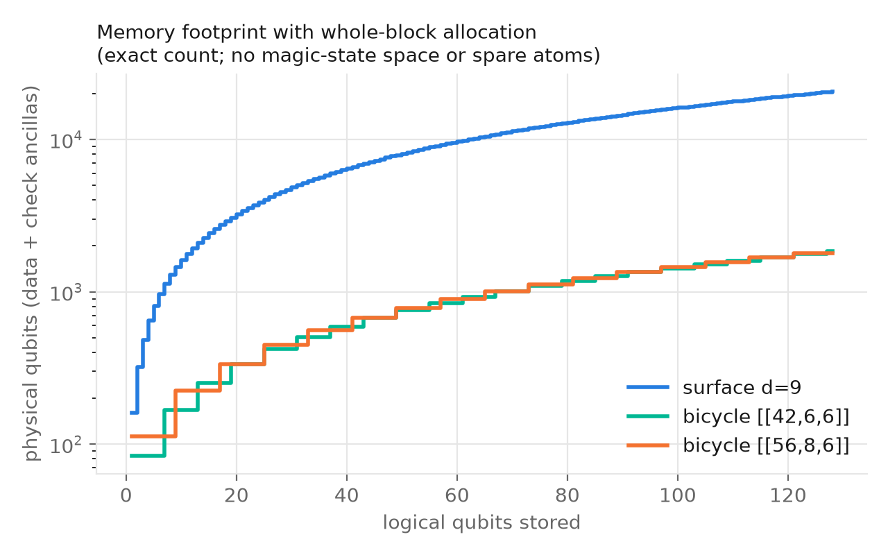
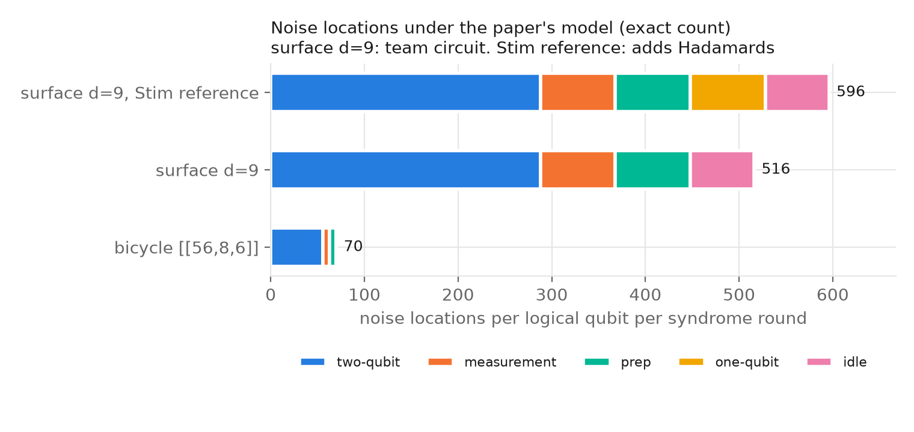
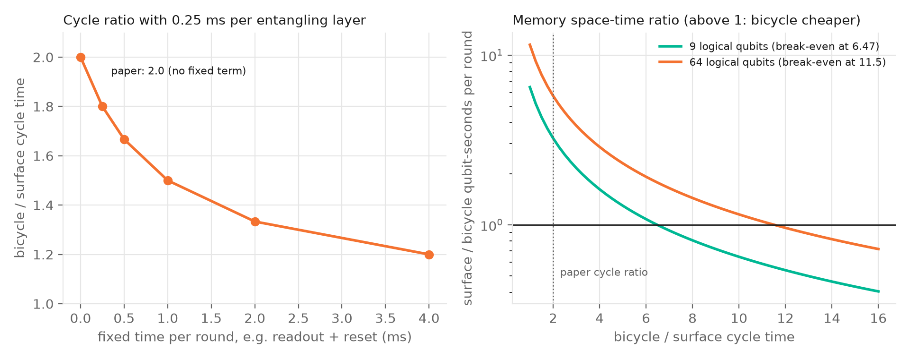
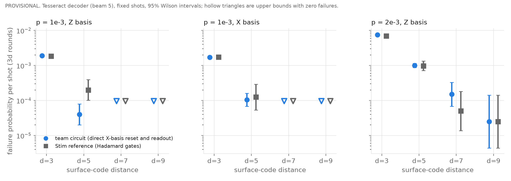

# Results

Two kinds of result are reported here and kept apart.

- **Part A, validated analytic results.** Exact counting and closed-form arithmetic. They do not
  depend on a decoder or on sampling, and the tests check them against hand calculations.
- **Part B, provisional sampled results.** They depend on a decoder that is not the paper's and on
  small shot counts. They are bounds and consistency checks. **They do not reproduce the paper's
  logical error rates.**

The surface-code numbers use the team's surface-code circuit (`qec_star.surface`, merged from the
surface-code owner's branch at `f377d22`). Earlier versions of this document used Stim's generated
circuit as a stand-in; what that changed is listed in "What changed with the team's surface circuit".

Part C is text for the group paper. Numbers behind figures 1-4 are in `figures/analytic.json`; raw
sampling records are in `results/udaya/`.

## Short answer to the research question

On memory alone, the bicycle chain's space advantage is large and robust to timing: at the paper's
code sizes it stores 64 logical qubits in 896 atoms against 10,304, and its syndrome cycle would have
to be 11.5 times slower than the surface code's, not 2 times, before the qubit-seconds were equal.
If some of a round's time does not scale with the number of gate layers (readout, for example), the
cycle ratio falls below 2, which helps the bicycle chain; whether it does depends on how real
hardware budgets that time, which the paper does not say.

Non-uniform noise cuts the other way, though less sharply than first estimated. The bicycle
circuit's fault budget is 80% two-qubit gate error against 56% for the surface circuit, so a hardware
profile dominated by the CZ gate raises its fault budget more (1.76 times against 1.62 times for a
profile built from published Rb-87 fidelities).

Whether the advantage survives end to end, at matched logical error, is **not answered** by this
workstream. That needs production-scale sampling and the algorithm volumes (see HANDOFF.md).

## What changed with the team's surface circuit

The team's circuit prepares and measures X-type ancillas directly in the X basis. Stim's generated
circuit, used before, does it with a Hadamard gate before and after the CNOTs. Both implement the
same code with the same 4-layer CNOT schedule depth, the same atoms and the same detectors.

| Finding | Status | Before (Stim reference) | Now (team circuit) |
|---|---|---|---|
| Atoms per patch, memory footprint, qubit ratio 11.5 | unchanged | 2d² − 1 = 161 at d = 9 | same |
| Cycle-time model, break-even ratio 11.5 | unchanged | | same |
| Bicycle-chain budgets and all bicycle results | unchanged | | same |
| Surface noise locations per round, d = 9 | **changed** | 596 | 516 (no one-qubit gates) |
| Surface two-qubit share of the budget | **changed** | 48% | 56% |
| Surface expected faults per round at p = 1e-3 | **changed** | 0.60 | 0.52 |
| Fault-budget factor, two-qubit error × 2 (surface) | **changed** | 1.48 | 1.56 |
| Fault-budget factor, literature-anchored profile (surface) | **changed** | 1.46 | 1.62 |
| Fault-budget factor, idle × 4 (surface) | **changed** | 1.34 | 1.40 |
| "Bicycle chain is more exposed to two-qubit error than the surface code" | holds, with a smaller gap | 1.80 vs 1.48 | 1.80 vs 1.56 |
| "The paper's idle channel never fires on the bicycle circuit, and does on the surface circuit" | holds | 68 idle locations per round | 68 |
| Sampled logical failure of the surface memory | no resolvable change | see B2 | see B2 |

The earlier limitation "the surface circuit has 80 extra noise locations from Hadamard gates" no
longer applies to the results; it now describes only the reference circuit.

## Part A. Validated analytic results

### A1. Memory footprint (figure 1)

| Logical qubits | Surface d = 9 | Bicycle [[56,8,6]] | Ratio | Unused bicycle capacity |
|---|---|---|---|---|
| 1 | 161 | 112 | 1.44 | 7 |
| 9 | 1,449 | 224 | 6.47 | 7 |
| 64 | 10,304 | 896 | 11.5 | 0 |
| 128 | 20,608 | 1,792 | 11.5 | 0 |

Data qubits plus one ancilla per check, in whole blocks. Per logical qubit this is 161 and 14, as in
the paper's Table 4. The ratio reaches 11.5 only when the blocks are full; a workload that does not
fill its last block pays for unused capacity.

This is larger than the paper's end-to-end 5.5× because it leaves out magic-state space. Reading the
paper's own numbers: its smallest TFIM footprint of 1,904 atoms equals 2 × (448 + 504) under
Eq. (32), where 448 is the data-qubit count for 64 logical qubits. On that reading more than half of
the bicycle footprint is not data storage. (An inference from the reported totals, not a statement
in the paper.)

### A2. Where the faults are (figure 2)

Noise locations per logical qubit per syndrome round under the paper's model:

| | two-qubit | measurement | preparation | one-qubit | idle | total |
|---|---|---|---|---|---|---|
| Surface d = 9 (team circuit) | 288 | 80 | 80 | 0 | 68 | 516 |
| Bicycle [[56,8,6]] | 56 | 7 | 7 | 0 | 0 | 70 |
| *Surface d = 9, Stim reference (for comparison)* | 288 | 80 | 80 | 80 | 68 | 596 |

For the team circuit at other distances the totals are 60 (d = 3), 164 (d = 5) and 316 (d = 7).

- At p = 1e-3 this is 0.52 expected faults per logical qubit per round for the surface code and 0.07
  for the bicycle chain. Per millisecond, with 1 ms and 2 ms cycles, it is 0.52 against 0.035.
- **The paper's idle channel never fires on the bicycle circuit.** All four atom arrays take part in
  every CNOT layer. Scaling the idle probability changes nothing for the bicycle chain; doubling it adds 13%
  to the surface code's fault budget.
- Neither team circuit contains a one-qubit gate, so the one-qubit error probability does not enter
  either budget.
- Fewer locations per logical qubit does not mean a lower logical error rate: the bicycle code has
  distance 6 (fault distance 5) against 9.

### A3. Timing and break-even (figure 3)

- The paper's cycle times are 0.25 ms × stabilizer weight for all three code families. The paper
  does not break this down, so readout may be amortized into the per-layer figure or left out; we
  cannot tell which.
- As a sensitivity calculation, add a fixed time F per round on top of 0.25 ms per layer. The ratio
  is (F + 8 × 0.25 ms) / (F + 4 × 0.25 ms): 2.0 at F = 0, 1.67 at 0.5 ms (the duration of one
  mid-circuit imaging step measured on hardware), 1.5 at 1 ms, 1.2 at 4 ms. Within this model, 2 is
  the largest ratio; any common fixed term lowers it.
- The ratio can exceed 2 only if a bicycle layer takes longer than a surface layer. Its checks reach
  up to four sites away, and move time grows as the square root of distance, so this is possible;
  no layout has been specified to quantify it.
- Memory qubit-seconds per round favor the bicycle chain by 5.75× at the paper's ratio and break
  even at a cycle ratio of 11.5 (6.47 for 9 logical qubits, because of block rounding).
- End to end, Eq. (33) makes runtime proportional to cycle time and Eq. (32) makes the atom count
  independent of it. If the two architectures run at comparable speed with a 5.5× atom advantage, as
  the paper reports, the qubit-second advantage is lost only when the bicycle cycle is a further
  5.5× slower than assumed, with everything else fixed. This holds noise fixed, which is not
  realistic for a slower cycle (see A4).

### A4. How scenarios change the fault budget (figure 4)

Expected faults per logical qubit per round, relative to the paper baseline:

| Scenario | Surface d = 9 | Bicycle [[56,8,6]] |
|---|---|---|
| two-qubit error × 2 | 1.56 | 1.80 |
| two-qubit error × 4 | 2.67 | 3.40 |
| measurement error × 2 | 1.16 | 1.10 |
| measurement error × 4 | 1.47 | 1.30 |
| idle error × 4 | 1.40 | 1.00 |
| literature-anchored Rb-87 profile | 1.62 | 1.76 |
| per-round idle, T2 = 1.5 s (measured) | 1.05 | 1.07 |
| per-round idle, T2 = 0.15 s (synthetic) | 1.52 | 1.66 |

- The bicycle chain is the more sensitive of the two to two-qubit gate error, the less sensitive to
  measurement error, and insensitive to the paper's gate-layer idle error. It is the more sensitive
  to idle error that grows with cycle duration (1.07 against 1.05, and 1.66 against 1.52), because
  its cycle is twice as long.
- At the measured coherence time, idling through a 1 ms or 2 ms cycle adds 5% and 7% to the fault
  budgets. It becomes comparable to the gate error only if coherence is ten times worse or cycles
  ten times longer. The measured 4.45 ms round is partway there.
- These are changes in how many faults occur, not in logical error. Turning them into logical error
  rates is the decoder-backed work in Part B and beyond.

## Part B. Provisional sampled results

**Status: provisional. Not the paper's decoders. Memory experiments only. Shot counts give bounds
or coarse estimates.** B1 is historical and used Stim's surface circuit; B2 uses the team's.

### B1. The decoder matters by orders of magnitude (figure 5, Stim reference circuit)

Failure of any logical observable per shot, r = 3d rounds, Z basis unless noted. The two columns
decode byte-identical circuits (equal SHA-256).

| Memory | p | Tesseract, fixed shots | 95% interval | BP+OSD-0 pilot |
|---|---|---|---|---|
| bicycle [[42,6,6]], Z | 1e-3 | 0 / 6,000 | ≤ 6.4e-4 | 166 / 2,400 = 6.9% |
| bicycle [[42,6,6]], X | 1e-3 | 1 / 6,000 | 2.9e-5 to 9.4e-4 | 156 / 2,400 = 6.5% |
| bicycle [[42,6,6]], Z | 2e-3 | 2 / 2,400 | 2.3e-4 to 3.0e-3 | 530 / 1,200 = 44% |
| Stim surface d = 5 | 1e-3 | 8 / 40,000 | 1.0e-4 to 3.9e-4 | 41 / 40,000 |
| Stim surface d = 7 | 1e-3 | 0 / 40,000 | ≤ 9.6e-5 | 2 / 40,000 |
| Stim surface d = 9 | 1e-3 | 0 / 40,000 | ≤ 9.6e-5 | 0 / 40,000 |
| Stim surface d = 5 | 2e-3 | 39 / 40,000 | 7.1e-4 to 1.3e-3 | 103 / 21,600 |
| Stim surface d = 7 | 2e-3 | 2 / 40,000 | 1.4e-5 to 1.8e-4 | not run |
| Stim surface d = 9 | 2e-3 | 1 / 40,000 | 4.4e-6 to 1.4e-4 | not run |

What this supports:

- On identical circuits, BP+OSD-0 gives a failure rate about two orders of magnitude above
  Tesseract's for the bicycle code, and about five times above it for the surface code at d = 5. It
  also mis-corrects sampled double faults that Tesseract corrects (VALIDATION.md). Its numbers
  describe the decoder, not the codes.
- With Tesseract, the [[42,6,6]] memory's failure rate at the paper's noise level is below 1e-3 per
  18-round shot in both bases. Divided by 6 logical qubits and 18 rounds, which is the paper's
  normalization of a block failure rate and not an error rate of any single logical qubit, the
  Z-basis bound is 6e-6. The paper quotes scales near 1e-7 for this code family. Our bound is
  consistent with that and far too loose to confirm it.
- The pilot's intervals are nominal (it stopped on a failure count). The fixed-shot intervals are
  Wilson intervals, which are approximate when very few failures are expected.

What it does not support:

- Any ranking of the bicycle code against surface d = 7 or d = 9: three of those cells saw no
  failures at p = 1e-3.
- Any statement about sensitivity to individual noise channels. At these failure rates each cell
  would need 10⁵ to 10⁶ shots. The validation run spent 1.1 to 1.3 worker-seconds per shot on the
  bicycle memory at p = 1e-3 and 5.2 at 2e-3 (recorded wall time × 12 workers), so that is a cluster job.
- The single X-basis failure flipped five of the six logical observables at once. The observables of
  a block fail together, which is why they are not counted as independent samples.

### B2. The team's surface circuit against the Stim reference (figure 6)

Tesseract (beam 5), r = 3d rounds, fixed shots; failures / shots. Team-circuit records and the d = 3
reference are in `validation_surface_team_tesseract.jsonl` (code revision `8dd53a5`); the d = 5, 7, 9
reference records are the earlier ones in `validation_tesseract.jsonl`.

| d | Scenario | Team circuit | 95% interval | Stim reference | reference / team (95%) |
|---|---|---|---|---|---|
| 3 | p = 1e-3, Z | 381 / 200,000 | 1.7e-3 to 2.1e-3 | 366 / 200,000 | 0.96 (0.83 to 1.11) |
| 3 | p = 1e-3, X | 344 / 200,000 | 1.6e-3 to 1.9e-3 | 345 / 200,000 | 1.00 (0.86 to 1.16) |
| 3 | p = 2e-3, Z | 1,503 / 200,000 | 7.2e-3 to 7.9e-3 | 1,380 / 200,000 | 0.92 (0.85 to 0.99) |
| 5 | p = 1e-3, Z | 8 / 200,000 | 2.0e-5 to 7.9e-5 | 8 / 40,000 | 5.0 (1.9 to 13) |
| 5 | p = 1e-3, X | 21 / 200,000 | 6.9e-5 to 1.6e-4 | 5 / 40,000 | 1.2 (0.45 to 3.2) |
| 5 | p = 2e-3, Z | 199 / 200,000 | 8.7e-4 to 1.1e-3 | 39 / 40,000 | 0.98 (0.70 to 1.4) |
| 7 | p = 1e-3, Z | 0 / 40,000 | ≤ 9.6e-5 | 0 / 40,000 | |
| 7 | p = 1e-3, X | 0 / 40,000 | ≤ 9.6e-5 | 0 / 40,000 | |
| 7 | p = 2e-3, Z | 6 / 40,000 | 6.9e-5 to 3.3e-4 | 2 / 40,000 | 0.33 (0.07 to 1.7) |
| 9 | p = 1e-3, Z | 0 / 40,000 | ≤ 9.6e-5 | 0 / 40,000 | |
| 9 | p = 1e-3, X | 0 / 40,000 | ≤ 9.6e-5 | 0 / 40,000 | |
| 9 | p = 2e-3, Z | 1 / 40,000 | 4.4e-6 to 1.4e-4 | 1 / 40,000 | 1.0 (0.06 to 16) |

The ratio interval is a log-normal approximation for two independent binomial counts.

What this supports:

- The team circuit decodes correctly at all four distances in both bases, and its failure rate falls
  with distance as it should at p = 1e-3 (1.9e-3 at d = 3, 4e-5 to 1.1e-4 at d = 5, no failures in 40,000 shots at d = 7 and 9).
- Where both circuits have enough failures to compare, their failure rates are the same within the
  intervals (d = 3 in all three scenarios; d = 5 at p = 2e-3). Removing the Hadamard gates takes out
  13% of the surface circuit's noise locations and has no effect we can resolve.

What it does not support:

- A claim that the team circuit is better. Two of the nine ratios exclude 1: d = 5, Z, p = 1e-3
  favors the team circuit (8 failures on each side), and d = 3, p = 2e-3 favors the reference by 8%.
  With nine comparisons, small counts in one and opposite signs, we treat neither as established.
  The d = 5 Z-basis rate (8 in 200,000) is also below the X-basis rate (21 in 200,000) on the same
  circuit; whether that is a real basis asymmetry needs more shots.
- Any estimate at d = 7 or d = 9 for p = 1e-3: no failures were seen in 40,000 shots.

A practical observation for production runs: Tesseract spent 590 to 1,580 s on a d = 9 cell of the
team circuit against 120 to 210 s on the reference with the same shots and workers. The two circuits
number their qubits and detectors differently, and Tesseract's search follows detector order. The
runs were not on an otherwise idle machine, so this is an indication to check, not a benchmark.

### B3. What was not run

The planned sweeps over one channel at a time, the idle scenarios and the literature-anchored
profile were not sampled with Tesseract. The 60-cell BP+OSD pilot was stopped after 19 cells
once the decoder was shown to be inadequate; its records are kept in
`results/udaya/pilot_bposd0_sequential.jsonl` and described in `results/udaya/README.md`.

## Part C. Text for the paper

### Methodology

We model hardware at the level of a circuit-level Pauli noise model and a per-round time budget, and
keep both separate from the construction of the error-correcting circuits. Noise is added to a
noiseless Stim circuit by inserting channels next to the existing instructions, which leaves
measurement records, detectors and logical observables unchanged. The reference model follows
Ref. [paper], Sec. III: each state preparation, one-qubit gate and two-qubit gate is followed by a
depolarizing channel of total probability p on the qubits involved; each measurement outcome is
flipped with probability p; and each qubit left idle during a layer of two-qubit gates receives a
one-qubit depolarizing channel of probability p, with p = 10⁻³ and no atom loss. We verified the
implementation by comparing the number of noise locations of each type against counts derived by
hand from the circuit structure, for the [[14ℓ, 2ℓ, 6]] bicycle-chain memory circuit and for the
rotated surface-code memory circuit at distances 3 to 9, in both bases. Both circuits prepare and
measure ancillas directly in the required basis and contain no one-qubit gates.

Departures from the reference are defined as named scenarios in which each parameter is labeled as
measured, assumed by Ref. [paper], derived by a stated formula, or synthetic. They scale one error
probability at a time, vary the ratio of syndrome-cycle durations, and add an idle error per round
derived from a coherence time T₂ as p = (1 − e^(−t/T₂))/2 for a cycle of duration t. One scenario
converts published ⁸⁷Rb gate fidelities to depolarizing probabilities by p = (d+1)(1 − F)/d for a
gate on a d-dimensional space; it combines results from different experiments and is an illustration
of a non-uniform error budget, not a calibration.

The duration of a syndrome round is modeled as t = L(t_gate + t_move) + t_fixed for L layers of
two-qubit gates, where each term is the wall-clock time of an operation applied in parallel to the
whole array. Physical-qubit counts are exact: data qubits plus one ancilla per check, in whole code
blocks. End-to-end resources use Eqs. (32)-(33) of Ref. [paper].

For sampled experiments the number of shots per configuration was fixed before sampling. A shot is
counted as failed if any logical observable is decoded incorrectly, and we report 95% Wilson score
intervals for the failure probability per shot. Detection events were decoded with the Tesseract
search decoder [Beni et al.] at a finite beam, for which it is a heuristic. As a diagnostic we drew
random sets of one, two and three faults from the detector error model (300, 300 and 150 sets) and
confirmed that it corrected all of them.

### Results

For 64 logical qubits, a memory built from [[56,8,6]] bicycle-chain blocks uses 896 physical qubits
and one built from distance-9 surface-code patches uses 10,304, a ratio of 11.5. With syndrome
cycles of 2 ms and 1 ms the ratio of qubit-seconds per round is 5.75, and the two are equal only if
the bicycle-chain cycle is 11.5 times longer than the surface-code cycle. The cycle durations assumed
in Ref. [paper] are proportional to the stabilizer weight; adding a duration per round that does not
depend on the number of gate layers, such as readout, lowers the ratio of cycle durations from 2
toward 1.

Per logical qubit and per round, the distance-9 surface-code circuit has 516 locations at which a
fault can occur and the bicycle-chain circuit has 70. Two-qubit gates account for 56% of the former
and 80% of the latter, and the bicycle-chain circuit has no qubit that is idle during a gate layer.
Doubling the two-qubit error probability therefore raises the expected number of faults by a factor
1.56 for the surface code and 1.80 for the bicycle chain, while quadrupling the idle error raises it
by 1.40 and 1.00. For error probabilities derived from published ⁸⁷Rb fidelities the factors are 1.62
and 1.76. An idle error per round derived from T₂ = 1.5 s adds 5% and 7%.

In an 18-round memory experiment on the [[42,6,6]] code at p = 10⁻³ we observed 0 failures in 6,000
shots in the Z basis and 1 in 6,000 in the X basis, which bounds the failure probability per shot
below 10⁻³ in each basis at 95% confidence. For the surface code under the same noise, with 3d
rounds, the failure probability per shot was 1.9 × 10⁻³ at distance 3 and 4 × 10⁻⁵ (Z basis) and
1.1 × 10⁻⁴ (X basis) at distance 5; no failures were observed in 40,000 shots at distances 7 and 9.

### Limitations

The sampled results are limited to memory experiments, to a decoder that differs from those of
Ref. [paper], and to shot counts that give upper bounds rather than estimates; we do not reproduce
the logical error rates of Ref. [paper]. At the code sizes of interest the sampled failure rates are
too low to rank the two codes. The comparison pairs a distance-9 surface code with a distance-6 bicycle-chain code, as
in Ref. [paper], and so is not made at equal logical error rate; counts of fault locations compare
exposure to noise and do not by themselves order the codes. The noise model contains Pauli errors
only: atom loss, leakage, transport errors and correlated or biased errors, all of which are
significant in current neutral-atom devices, are absent, and the idle error derived from T₂ is
applied as a depolarizing rather than a dephasing channel. Cycle durations are assumptions inherited
from Ref. [paper]; a complete error-correction round on current hardware has been measured at about
4.5 ms. The durations of the atom moves required by the bicycle-chain schedule were not modeled.
End-to-end resources were not evaluated because they require the rotation and Clifford volumes of
the target simulations and the allocation of magic-state space.
